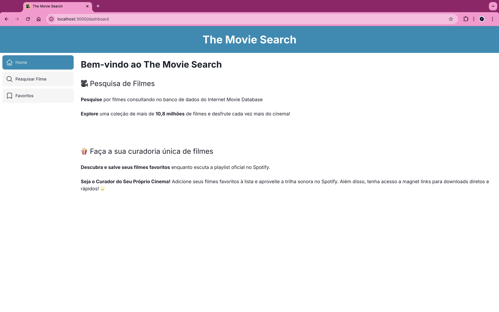
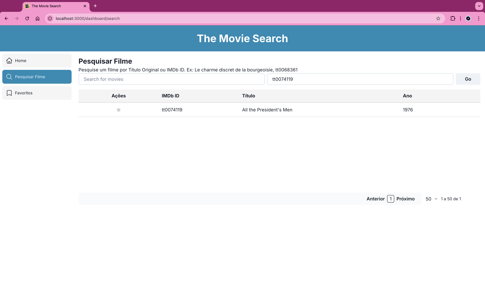
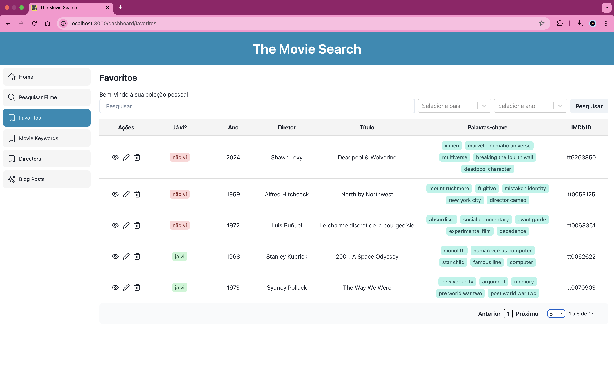
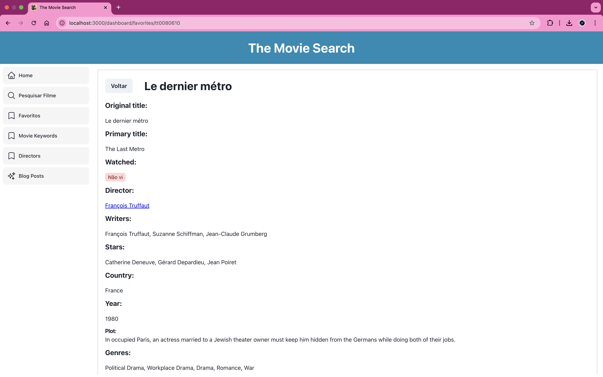
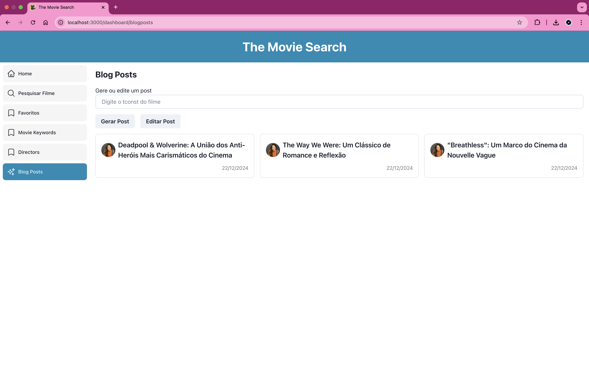

# The Movie Search

É uma aplicação centrada na experiência do amante de cinema.

Backend deste projeto: https://github.com/francisdiasbr/movie-search-backend

O usuário pode pesquisar por filmes, obter informações sobre eles, salvá-los em uma lista de favoritos e editá-los.







## Features

### 1. Pesquisa de Filmes

O usuário pode pesquisar por um filme através do nome do filme ou do código IMDb (ex: tt0111161). O catálogo de filmes é fornecido pelo IMDb e contém a base de dados completa.

Como resultado, a resposta fornece uma tabela populada contendo filmes relacionados à pesquisa.

Ao pesquisar por um filme, o usuário pode:

- Ver apenas 3 informações do filme: o nome do filme, o código IMDb o ano de produção.
- Favoritar um filme em sua coleção de favoritos.

### 2. Coleção de Favoritos

O usuário tem uma tabela contendo os filmes favoritos:

- Coluna "Ações" com os botões de visualizar, editar e excluir.
- Coluna "Já vi?" com um botão para marcar se o filme foi visto.
- Coluna "Ano" com o ano de lançamento do filme.
- Coluna "Diretor" com o nome do diretor do filme.
- Coluna "Título Original" com o título original, na língua original do filme.
- Coluna "Título" com o título do filme.
- Coluna "Palavras-chave" com as palavras-chave associadas ao filme.
- Coluna "IMDb ID" com o código IMDb do filme.

- Ver todos os filmes favoritos.
- Editar as informações de um filme favorito (link da Wikipedia e trilha sonora do filme no Spotify).
- Excluir um filme favorito.


### 3. Visualização de Filme Favorito

O usuário pode visualizar as informações de um filme favorito:

- Nome do filme
- Código IMDb
- Diretor
- País
- Ano de lançamento
- Roteiro / Plot
- Plot Keywords (palavras chaves associadas ao filme)
- Link do filme na Wikipedia
- Trivia / Curiosidades (lista de fatos interessantes sobre o filme)
- Quotes (lista de frases célebres do filme)
- Trilha sonora do filme (integração com o Spotify)
- Magnet Link para download do filme

### 4. Idioma dos textos (EN / PT)

O seletor EN / PT na barra de navegação troca o idioma dos textos dos filmes
(sinopse, trivia, citações, gêneros e palavras-chave). O português é gerado pelo
backend com o Argos Translate, um tradutor offline sem custo. A escolha vale
para o app inteiro e fica salva no navegador; um favorito antigo é traduzido na
primeira vez que é aberto em PT.

### 5. Sugestão de filmes por palavras-chave

Na tela de palavras-chave favoritadas, o usuário seleciona uma ou mais e recebe
os filmes que o IMDb associa a elas, com gêneros e sinopse. A busca é feita pelo
backend na API do próprio IMDb; filmes que casam com mais palavras-chave vêm
primeiro.

## Estrutura do projeto

Cada pasta de rota em `app/dashboard/` é uma feature e tem seu próprio `service/` (chamadas à API), além de `reducer/` e `types.ts` quando a tela guarda estado no Redux. Duas features podem usar o mesmo recurso do backend e ainda assim cada uma tem o seu service.

| Feature | service | reducer | Recurso no backend |
|---|---|---|---|
| `favorites/` | `FavoritesService`, `MainImagesService` | `favoritesSlice`, `movieDetailsSlice`, `mainImagesSlice` | `favorites`, `main-images` |
| `search/` | `SearchService` | `searchSlice` | `favorites` |
| `reviews/` | `ReviewsService`, `ImagesService` | `authoralReviewSlice`, `imagesSlice` | `write-review`, `images` |
| `read/` | `ReadService` | `readSlice` | `write-review` |
| `write/` | `WriteService` | nenhum | `write-review`, `favorites` |
| `write-review/` | `WriteReviewService` | `writeReviewSlice` | `write-review` |
| `keywords/` | `KeywordsService` | `keywordsSlice` | `keywords` |

O idioma dos textos é uma preferência global: `app/userPreferences/` (slice,
action e storage em localStorage) guarda a escolha e `app/language/LanguageProvider.tsx`
a expõe pelo hook `useLanguage()`, usado pelo seletor da barra de navegação
(`app/dashboard/components/LanguageSelector`) e pela página do filme.

A infraestrutura fica em `lib/`: `api/BaseApi.ts` (axios + `ApiError`), `service/BaseService.ts` (classe base dos services, por `prefix`), `store.ts` e `hooks.ts`. Utilitários transversais ficam em `app/const.ts`, `app/formatter/`, `app/util/` e `app/hooks/`. Mais detalhes em [CLAUDE.md](CLAUDE.md).

## Rodando a aplicação

Antes de iniciar a aplicação, é imprescindível que o backend esteja em execução. Você pode encontrar as instruções para configurar e rodar o backend neste repositório: [movie-search-backend](https://github.com/francisdiasbr/movie-search-backend).

### Passos para rodar a aplicação:

1. **Instale as dependências**:

   ```bash
   npm install
   # ou
   yarn
   ```

2. **Inicie o servidor de desenvolvimento**:
   ```bash
   npm run dev
   # ou
   yarn dev
   ```

## Uso de Magnet Links

Esta aplicação permite o uso de magnet links para download de conteúdo. Os magnet links são uma forma de compartilhar arquivos via protocolo BitTorrent, permitindo downloads descentralizados.

### Aviso Legal

- **Conteúdo**: Certifique-se de que o conteúdo que você está baixando ou compartilhando é legal e não infringe direitos autorais.
- **Responsabilidade**: A responsabilidade pelo uso de magnet links e pelo conteúdo baixado é exclusivamente do usuário. A aplicação não se responsabiliza por qualquer uso ilegal.
