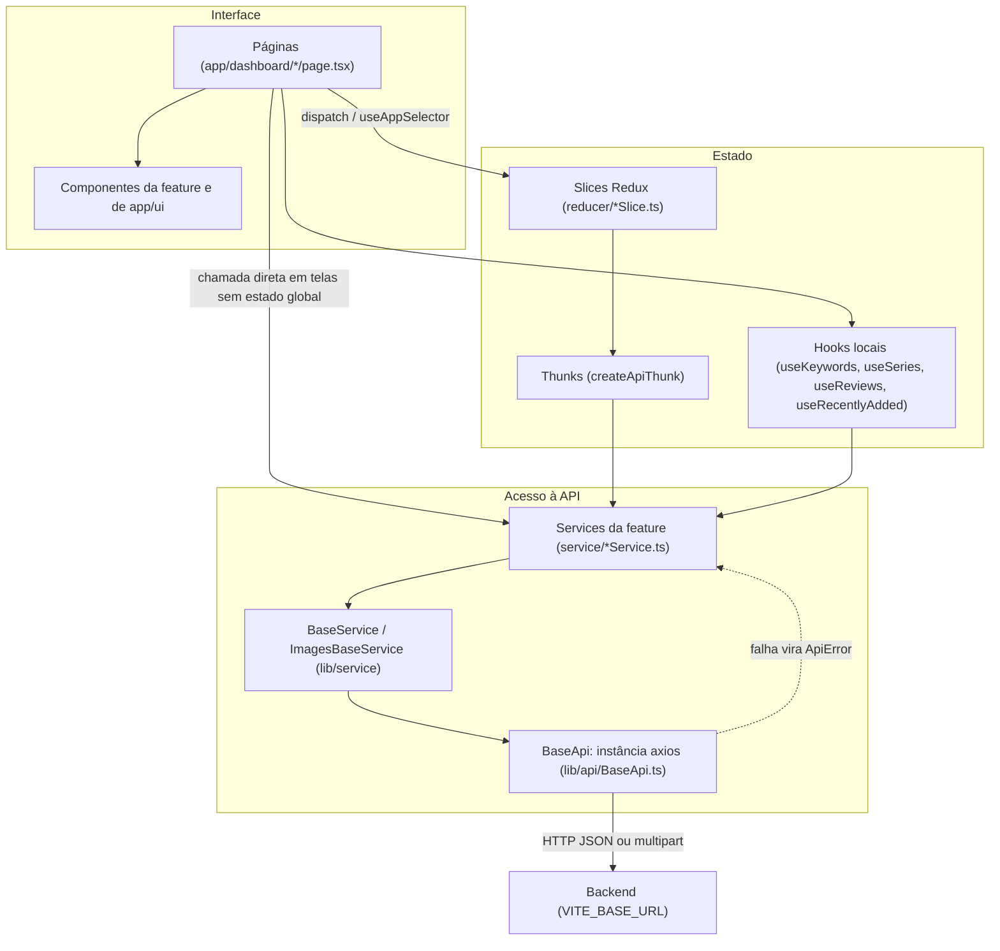
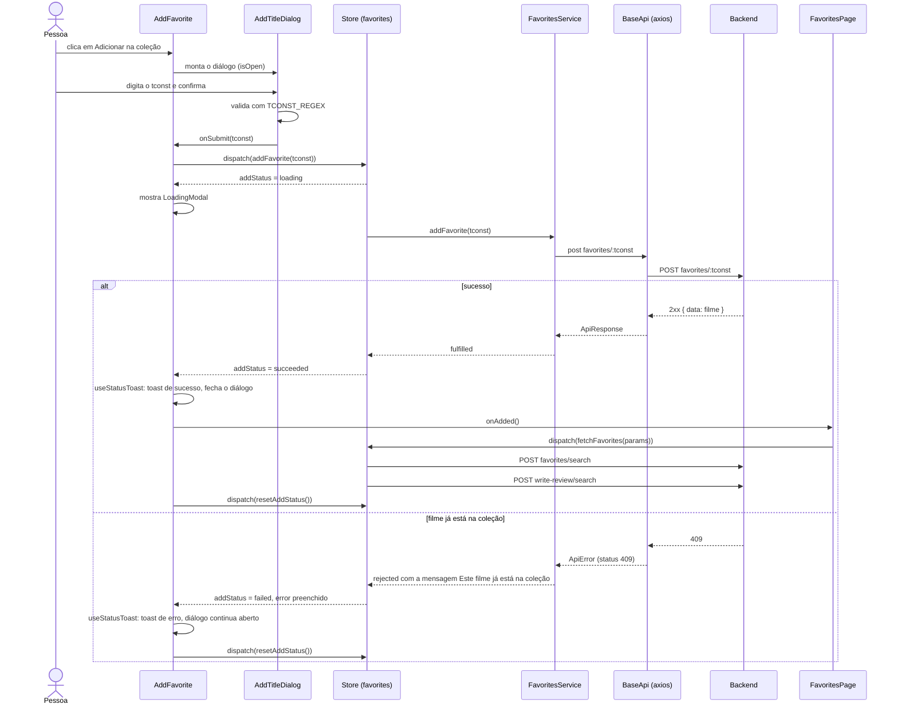

# Arquitetura

## Stack

| Peça | Biblioteca | Onde entra |
|---|---|---|
| Interface | React 18 | `app/main.tsx`, `app/App.tsx` |
| Linguagem | TypeScript 5 (`strict`) | `tsconfig.json` |
| Bundler e servidor de desenvolvimento | Vite 8 com `@vitejs/plugin-react` | `vite.config.ts` |
| Rotas | `react-router-dom` 7 (`createBrowserRouter`) | `app/router.tsx` |
| Estado global | Redux Toolkit e `react-redux` | `lib/store.ts`, `lib/hooks.ts` |
| HTTP | `axios` | `lib/api/BaseApi.ts` |
| Estilos | `styled-components` 6 | `app/theme/`, arquivos `styles.ts` |
| Avisos (toasts) | `sonner` | `app/App.tsx`, `app/hooks/useToastNotifications.ts` |
| Ícones | `react-icons` (conjunto `fa`) | componentes |
| Fontes | `@fontsource/montserrat`, `@fontsource/roboto` | `app/theme/GlobalStyle.ts` |

## Estrutura de pastas

```
index.html            ponto de entrada do Vite; carrega /app/main.tsx
vite.config.ts        plugin do React e alias "@" para a raiz
lib/
  api/                BaseApi (axios), ApiError, createApiThunk/addStatusCases, tipos de resposta
  service/            BaseService e ImagesBaseService
  store.ts            configureStore com os sete reducers
  hooks.ts            useAppDispatch, useAppSelector, useAppStore
app/
  main.tsx            createRoot
  App.tsx             provedores: tema, store, idioma, rotas, Toaster
  StoreProvider.tsx   cria a store uma única vez (useRef)
  router.tsx          tabela de rotas
  const.ts            ROUTES e TCONST_REGEX
  dashboard/          layout com a barra de navegação e uma pasta por feature
  ui/                 componentes genéricos, sem regra de negócio
  theme/              tokens de design e estilos globais
  language/           LanguageProvider e useLanguage
  userPreferences/    slice, action e storage do idioma
  hooks/              hooks usados por mais de uma feature
  formatter/          formatadores de exibição
  util/               funções puras (URLs, tconst, opções de select)
public/               favicon e capturas de tela usadas no README da raiz
```

### Pastas de feature

Cada pasta em `app/dashboard/` é uma feature. O nome da pasta não define a URL; quem define é `app/router.tsx`.

| Pasta | Conteúdo | Guarda estado em |
|---|---|---|
| `favorites/` | `page.tsx`, `columns.tsx`, `[tconst]/` (detalhe), `components/` (`AddFavorite`, `Search`, `WatchedTag`, `YearRange`), `service/`, `reducer/`, `types.ts` | Redux (`favorites`, `favoriteDetails`, `mainImages`) |
| `reviews/` | `[tconst]/page.tsx`, `[tconst]/components/` (`LanguageCard`, `ReviewImageCard`), `service/`, `reducer/`, `types.ts` | Redux (`review`, `reviewImages`) |
| `write-review/` | `page.tsx`, `Form/`, `service/`, `reducer/`, `types.ts` | Redux (`writeReview`) |
| `write/` | `page.tsx`, `service/WriteService.ts` | estado local da página |
| `read/` | `page.tsx`, `useReviews.ts`, `service/`, `types.ts` | hook local `useReviews` |
| `keywords/` | `page.tsx`, `useKeywords.ts`, `components/SuggestedMovieCard`, `service/`, `types.ts` | hook local `useKeywords` |
| `series/` | `page.tsx`, `columns.tsx`, `useSeries.ts`, `service/`, `types.ts`, `styles.ts` | hook local `useSeries` |
| `belas-artes/` | `page.tsx`, `columns.tsx`, `useRecentlyAdded.ts`, `service/`, `types.ts` | hook local `useRecentlyAdded` |
| `components/` | `AddTitleDialog`, `GoBack`, `LanguageSelector`, `WatchedBadge` | compartilhados entre features do dashboard |

Regras que o código segue:

- Cada feature tem o seu próprio service, mesmo quando duas features usam o mesmo recurso do backend. `write`, `write-review`, `read` e `reviews` têm, cada uma, um service com `prefix = 'write-review'`.
- Uma feature não importa o service de outra. Quando precisa de outro recurso, chama pelo próprio service passando o prefixo (por exemplo `FavoritesService.findReviewedTconsts` chama `write-review/search`, e `KeywordsService.addToCollection` chama `favorites/<tconst>`).
- Importar tipos, slices e hooks de outra feature é permitido. A tela de detalhe do favorito usa `useKeywords` de `keywords/`, e `WriteService` usa tipos de `favorites/` e `reviews/`.
- Componentes estilizados ficam sempre em um `styles.ts` ao lado do componente e são importados como `* as S`.

## Camadas



## Inicialização

`index.html` carrega `app/main.tsx`, que monta `<App />` em `#root`. `App.tsx` aninha os provedores nesta ordem:

1. `ThemeProvider` com `theme`, seguido de `GlobalStyle`.
2. `StoreProvider`, que chama `makeStore()` uma vez e guarda a store em um `useRef`.
3. `LanguageProvider`, que precisa estar dentro da store porque lê o idioma dela.
4. `RouterProvider` com o router e o `Toaster` do sonner (`position='bottom-center'`).

Não há `React.StrictMode` em `main.tsx`.

## Roteamento

`app/router.tsx` usa `createBrowserRouter`. A raiz `/` redireciona para `ROUTES.favorites` com `<Navigate replace />`. Todas as telas são filhas de `/dashboard`, cujo elemento é `DashboardLayout` (`app/dashboard/layout.tsx`).

| Caminho | Componente | Está na barra de navegação |
|---|---|---|
| `/` | redireciona para `/dashboard/favorites` | não |
| `/dashboard/favorites` | `FavoritesPage` | sim, "Minha coleção" |
| `/dashboard/favorites/:tconst` | `FavoriteDetailPage` | não |
| `/dashboard/series` | `SeriesPage` | sim, "Séries" |
| `/dashboard/keywords` | `KeywordsPage` | sim, "Palavras-chave favoritadas" |
| `/dashboard/write` | `WritePage` | sim, "Escrever" |
| `/dashboard/write-review` | `WriteReviewPage` | não |
| `/dashboard/read` | `ReadPage` | sim, "Ler" |
| `/dashboard/reviews/:tconst` | `ReviewPage` | não |
| `/dashboard/belas-artes` | `BelasArtesPage` | sim, "Belas Artes" |

Pontos a saber:

- Os caminhos são centralizados em `ROUTES` (`app/const.ts`). `ROUTES.favorite(tconst)` e `ROUTES.review(tconst)` montam os caminhos com parâmetro, e `ROUTES.writeReview({ tconst, primaryTitle })` monta a query string de `/dashboard/write-review`.
- Não existe rota de "não encontrado" nem `errorElement`. Um caminho desconhecido cai na tela de erro padrão do React Router. O caminho `/dashboard` sozinho mostra só a barra de navegação, porque não há rota índice.
- As páginas são importadas de forma estática; não há carregamento sob demanda (`lazy`).

### Layout do dashboard

`DashboardLayout` desenha uma `<nav>` fixa no topo (`position: sticky`) com a lista de links (`NavLink`) e o `LanguageSelector`, e um `<main>` com o `<Outlet />`. O link da rota ativa recebe uma borda inferior pelo seletor `a[aria-current='page']`. Em telas estreitas a lista de links rola na horizontal em vez de quebrar a linha.

## Store Redux

`lib/store.ts` exporta `makeStore()`, além dos tipos `AppStore`, `AppDispatch` e `RootState`. Os hooks tipados (`useAppDispatch`, `useAppSelector`, `useAppStore`) ficam em `lib/hooks.ts`. Os slices não moram em `lib/`: cada um fica na pasta `reducer/` da sua feature.

### Forma do estado

| Chave em `RootState` | Arquivo | Campos |
|---|---|---|
| `favorites` | `favorites/reducer/favoritesSlice.ts` | `entries: FavoriteEntry[]`, `total_documents`, `countries: string[]`, `startYears: number[]`, `status`, `addStatus`, `error` |
| `favoriteDetails` | `favorites/reducer/movieDetailsSlice.ts` | `data: MovieDetailsItem \| null`, `fetchStatus`, `editStatus`, `deleteStatus`, `translateStatus`, `error` |
| `mainImages` | `favorites/reducer/mainImagesSlice.ts` | `images: ImageItem[]`, `status`, `error` |
| `review` | `reviews/reducer/authoralReviewSlice.ts` | `data: MovieReviewResponse \| null`, `status`, `error` |
| `reviewImages` | `reviews/reducer/imagesSlice.ts` | `images: ImageItem[]`, `status`, `uploadStatus`, `subtitleStatus`, `error` |
| `writeReview` | `write-review/reducer/writeReviewSlice.ts` | `status`, `error` |
| `userPreferences` | `userPreferences/reducer/userPreferencesSlice.ts` | `language: 'en' \| 'pt'` |

Todo campo de status é do tipo `AsyncStatus` (`'idle' | 'loading' | 'succeeded' | 'failed'`, em `lib/api/types.ts`). Cada slice tem um único campo `error`, compartilhado por todos os thunks daquele slice.

### Thunks

| Thunk | Tipo da action | Slice e campo de status | O que faz |
|---|---|---|---|
| `fetchFavorites` | `movies/favorites` | `favorites.status` | Busca a página da coleção e depois marca `hasReview` em cada item com uma segunda chamada. |
| `addFavorite` | `movies/addFavorite` | `favorites.addStatus` | Adiciona um filme pelo `tconst`. Um 409 vira a mensagem "Este filme já está na coleção.". |
| `fetchDetails` | `movie/details` | `favoriteDetails.fetchStatus` | Carrega o favorito no idioma pedido. |
| `translateDetails` | `movie/translate` | `favoriteDetails.translateStatus` | Pede a tradução para português e substitui `data`. |
| `editDetails` | `movies/edit` | `favoriteDetails.editStatus` | Grava campos editáveis. Ao concluir, mantém os textos em português que já estavam na tela (`pickTexts`). |
| `deleteFavorite` | `movie/deleteFavorite` | `favoriteDetails.deleteStatus` | Remove o filme da coleção. |
| `fetchMainImage`, `uploadMainImage`, `deleteMainImage` | `mainImages/fetch`, `mainImages/upload`, `mainImages/delete` | `mainImages.status` | Leem a lista de imagens; as duas escritas releem a lista em seguida. |
| `fetchAuthoralReview`, `updateAuthoralReview` | `authoralReview/fetchById`, `authoralReview/update` | `review.status` | Carregam e atualizam a resenha. `fetchAuthoralReview` devolve `MovieReviewResponse \| null`: um 404 conclui com sucesso e `data` nulo. |
| `fetchImages`, `deleteImage` | `reviewImages/fetch`, `reviewImages/delete` | `reviewImages.status` | Galeria da resenha. |
| `uploadMovieImage` | `reviewImages/upload` | `reviewImages.uploadStatus` | Envia uma imagem e relê a galeria. |
| `updateImageSubtitle` | `reviewImages/updateSubtitle` | `reviewImages.subtitleStatus` | Grava a mesma legenda em `subtitle_pt` e `subtitle_en` e relê a galeria. |
| `createReview` | `writeReview/create` | `writeReview.status` | Cria a resenha. |

Actions síncronas: `resetAddStatus` e `resetState` (favorites), `resetDeleteStatus`, `resetTranslateStatus` e `resetState` (favoriteDetails), `clearState` (review), `resetWriteReview` (writeReview) e `setLanguage` (userPreferences).

### Como os thunks são montados

Nenhum slice escreve `pending`, `fulfilled` e `rejected` à mão. Dois utilitários em `lib/api/thunk.ts` cuidam disso:

- `createApiThunk(type, fn, fallbackMessage)` embrulha `createAsyncThunk`. Executa `fn` e, se ela falhar, rejeita com `rejectWithValue(toApiErrorPayload(error, fallbackMessage))`. O valor rejeitado é sempre um `ApiErrorPayload` serializável: `{ message, status?, cancelled? }`.
- `addStatusCases(builder, thunk, statusKey, onFulfilled?)` liga os três casos ao campo de status indicado. Em `pending` põe `'loading'` e limpa `error`. Em `fulfilled` põe `'succeeded'` e chama `onFulfilled`. Em `rejected` põe `'failed'` e grava `payload.message` em `error`, exceto quando `payload.cancelled` é verdadeiro: uma requisição cancelada foi substituída por outra mais nova e não muda o status.

### Telas sem Redux

Quando o resultado só interessa a uma tela, o código não cria slice. Nesses casos um hook da própria feature guarda `status` e os dados com `useState` e chama o service diretamente: `useKeywords`, `useSeries`, `useReviews` e `useRecentlyAdded`. A tela "Escrever" chama `WriteService` direto da página. A tela de favoritos também chama `favoritesService.removeReview` direto da página, fora do Redux.

Cada chamada de `useKeywords()` cria um estado próprio. A tela de palavras-chave e a tela de detalhe do favorito não compartilham a lista; cada uma carrega a sua.

## Chamadas à API

São três camadas. Nenhuma URL é montada fora de um service, e as features não importam `BaseApi` diretamente.

### 1. `BaseApi` (`lib/api/BaseApi.ts`)

É um singleton sobre uma instância do axios criada com `baseURL: import.meta.env.VITE_BASE_URL`.

- Métodos: `get(url, options)`, `post(url, body, options)`, `put(url, body, options)`, `remove(url, body, options)` e o genérico `fetch(url, options)`. Todos devolvem `response.data`, já tipado pelo parâmetro genérico.
- O corpo vai em `data`. O código não define `Content-Type`; o axios serializa objetos como JSON e envia `FormData` como multipart.
- `cancelPrevious: true` aborta a requisição anterior ainda em andamento para o mesmo par método + URL, usando um `AbortController` guardado em `requestsMap`. É usado nas buscas disparadas enquanto a pessoa digita (`favorites/search` e `series/search`).
- Um interceptor de resposta converte toda falha em `ApiError`. Quem chama nunca recebe um `AxiosError`.
- Não há cabeçalho de autenticação, timeout configurado nem nova tentativa automática.

### 2. `BaseService` (`lib/service/BaseService.ts`)

Classe abstrata. A subclasse define `protected prefix = '<recurso>'` e herda:

| Método | URL resultante |
|---|---|
| `get(id?, prefix?, options?)` | `<prefix>` ou `<prefix>/<id>` |
| `post(body?, prefix?, options?)` | `<prefix>` (o segundo argumento permite passar um caminho completo) |
| `put(id, body?, prefix?, options?)` | `<prefix>/<id>` |
| `remove(id, prefix?, options?)` | `<prefix>/<id>` |
| `path(...segments)` | junta `prefix` e os segmentos com `/`, ignora vazios e aplica `encodeURIComponent` em cada segmento |

`ImagesBaseService` (`lib/service/ImagesBaseService.ts`) estende `BaseService` com o contrato comum a `images` e `main-images`: `list(tconst)`, `upload(tconst, file)` (monta o `FormData` com o campo `file`), `removeImage(tconst, filename)` e `updateSubtitle(tconst, filename, body)`. `MainImagesService` e `ImagesService` só definem o `prefix`.

### 3. Services das features

Cada service é uma classe exportada como singleton, com métodos nomeados pela operação de negócio (`favoritesService.searchFavorites(params)`, `keywordsService.suggestMovies(keywords)`, `seriesService.setWatched(tconst, watched)`). A lista completa de métodos e rotas está em [api-consumida.md](api-consumida.md).

### Base URL e variáveis de ambiente

A única variável lida pelo código é `VITE_BASE_URL`, usada em `BaseApi.url`. O `.env.example` traz `http://127.0.0.1:5000/api/`. Os caminhos montados pelos services são relativos (sem barra inicial), então a base precisa terminar com `/`. Se a variável não estiver definida, o axios fica sem `baseURL` e as chamadas vão para a própria origem do Vite.

### Envelopes de resposta

`lib/api/types.ts` define os dois formatos que o frontend espera:

- `ApiResponse<T>`: `{ data: T }`, usado pela maioria das rotas de item.
- `EntriesResponse<T>`: `{ entries: T[], total_documents?: number }`, usado pelas rotas de listagem e busca.

As rotas de imagens fogem dos dois: a listagem devolve `{ images: ImageItem[] }` e o upload devolve `{ object_name, url? }`.

### Tratamento de erro

`ApiError` (`lib/api/errors.ts`) tem `message`, `status`, `body` e `cancelled`.

| Situação | `ApiError` resultante |
|---|---|
| O backend respondeu com erro HTTP | `ApiError.fromResponse(status, body)`. A mensagem vem de `body.data` se for string, senão de `body.message` se for string, senão `"HTTP error <status>"`. |
| Requisição abortada por `cancelPrevious` | `ApiError.cancelled()`, com `cancelled: true` e `status: 0`. |
| Sem resposta (rede, backend fora do ar, CORS) | `status: 0` e a mensagem do axios, ou `"Network error"`. |
| Qualquer outra exceção | `status: 0` e a mensagem do erro, ou `"Unexpected error"`. |

O mesmo arquivo exporta `nullIfNotFound(promise)`, que devolve `null` quando a promessa falha com um `ApiError` de status 404 e relança qualquer outro erro. Serve para recursos em que o 404 é uma resposta esperada ("ainda não existe"), não uma falha. É usado em `WriteService.findReview` e no thunk `fetchAuthoralReview`, porque o backend responde 404 em `GET write-review/:tconst` quando o filme não tem resenha.

A partir daí há dois caminhos até a pessoa:

- **Telas com Redux.** O thunk rejeita com `ApiErrorPayload` e o reducer grava a mensagem em `state.error`. O hook `useStatusToast` observa o campo de status e, quando ele vira `'failed'`, mostra um toast de erro. Se `errorMessage` for uma string, o toast mostra `error` (a mensagem vinda do backend) quando ela existe, e `errorMessage` só quando não existe. Se `errorMessage` for uma função, é ela que decide o texto.
- **Telas sem Redux.** O hook ou a página captura a exceção em `try/catch`, usa `isApiError(error)` para olhar `status` (404 e 409 têm tratamento próprio em alguns lugares) e chama `showError`, `showInfo` ou `showWarning`.

`API_MESSAGE(message, fallback)` (`app/formatter/apiMessage.ts`) traduz mensagens conhecidas do backend por um dicionário. Hoje o dicionário tem uma única entrada.

Não existe tratamento global de 401/403 (o comentário em `BaseApi` indica onde ele entraria) nem um `ErrorBoundary` de React.

### Fluxo real: adicionar um favorito

O diagrama segue o código de `AddFavorite`, `AddTitleDialog`, `favoritesSlice` e `FavoritesService`.



## Tema e estilos

Todos os tokens de design ficam em `app/theme/`.

- `base/` contém só os contratos TypeScript (`Colors`, `Fonts`, `Layout`).
- `movieSearch/` contém os valores (`colors.ts`, `fonts.ts`, `layout.ts`) e monta o objeto `theme`.
- `index.ts` exporta `theme`, `ThemeProvider` (reexportado do styled-components) e `GlobalStyle`.
- `styled.d.ts` estende `DefaultTheme`, então `${({ theme }) => theme.colors.primary.main}` é tipado em qualquer `styles.ts`.

| Grupo | Tokens |
|---|---|
| `theme.colors` | `primary` (`main` `#A34F88`), `secondary` (`main` `#F49BD1`), `error`, `info`, `success`, cada um com `main`, `light`, `dark` e `contrastText`; `neutral.level1` a `neutral.level11` (do mais escuro ao mais claro), além de `black`, `white` e `transparent`; `background.page` (`#FFF6FB`) e `background.surface` (`#FFFFFF`). |
| `theme.fonts` | `fontPrimary` (Montserrat, usada em títulos e navegação), `fontSecondary` (Roboto, usada no corpo) e os pesos `thin` 100, `light` 300, `regular` 400, `medium` 500, `bold` 700. |
| `theme.spacing` | Função `spacing(n)` que devolve `n * 8px`, e os passos `xxs` 2px, `xs` 4px, `sm` 8px, `md` 16px, `lg` 24px, `xl` 32px, `xxl` 48px. |
| `theme.radius` | `sm` 4px, `md` 8px, `lg` 12px, `pill` 999px. |
| `theme.shadows` | `sm`, `md`, `lg`. |
| `theme.breakpoints` | `sm` 600px, `md` 900px, `lg` 1200px. |
| `theme.zIndex` | `nav` 100, `dialog` 1000, `toast` 1100. |

`GlobalStyle.ts` importa os arquivos de fonte do `@fontsource` e define os estilos de elementos: `box-sizing`, cor e fonte do `body`, tamanhos de `h1` a `h3`, links, campos (`input`, `textarea`, `select`), estado `:disabled` e a aparência do `<dialog>` nativo (largura de 600px, `max-width: 90vw`, fundo escurecido no `::backdrop`). Não existe arquivo `.css` no projeto.

Há um único tema; não há modo escuro.

## Idioma (pt/en)

O seletor EN/PT troca o idioma dos textos dos filmes que o backend traduz. Os textos da interface (rótulos, botões, mensagens) são fixos em português no código; não existe biblioteca de internacionalização.

Peças envolvidas:

1. `UserPreferencesStorage` (`app/userPreferences/service/`) lê e grava a chave `movie-search:language` no `localStorage`. Quando não há valor salvo, usa `'pt'` se `navigator.language` começar com `pt`, e `'en'` caso contrário.
2. `userPreferencesSlice` usa esse valor como estado inicial e expõe `setLanguage` e o seletor `selectUserLanguage`.
3. `dispatchLanguage(language)` (`app/userPreferences/action/`) grava no `localStorage` e despacha `setLanguage`.
4. `LanguageProvider` (`app/language/`) lê o idioma da store e entrega `{ language, changeLanguage }` por contexto. `useLanguage()` lança erro se for usado fora do provedor.
5. `LanguageSelector`, na barra de navegação, chama `changeLanguage`.

Hoje só a tela de detalhe do favorito reage ao idioma. Ela envia `?lang=<idioma>` em `GET favorites/<tconst>` e, se pediu `pt` e a resposta veio com `lang` diferente de `pt`, dispara `POST favorites/<tconst>/translate`. Se a tradução falhar, a tela volta o idioma global para `en`. As outras telas não leem `useLanguage`.

## Preferências do usuário

`app/userPreferences/` guarda só o idioma. Como não há conta de usuário, a persistência é local ao navegador. O estado fica em `RootState.userPreferences.language`.

## Hooks compartilhados

`app/hooks/` tem apenas hooks usados por mais de uma feature.

| Hook | Assinatura | Comportamento |
|---|---|---|
| `useStatusToast` | `({ status, error?, successMessage?, errorMessage?, onSuccess?, onFailure?, reset? })` | Reage quando `status` muda. Em `'succeeded'` mostra o toast de sucesso, chama `onSuccess` e `reset`. Em `'failed'` mostra o toast de erro, chama `onFailure` e `reset`. O efeito depende só de `status`. |
| `useToastNotifications` | `() => { showSuccess, showError, showWarning, showInfo }` | Camada fina sobre o sonner. Cada função recebe `{ title, duration? }`; a duração padrão é 3000 ms. |
| `useAsyncAction` | `(fn) => { run, loading }` | Executa `fn` com um indicador `loading` e ignora chamadas feitas enquanto a anterior não terminou. |
| `useDebouncedEffect` | `(effect, deps, delay = 500)` | Executa `effect` depois que `deps` param de mudar por `delay` ms. Não executa na montagem. |
| `useFilePicker` | `(onFile, { accept = 'image/*' }) => { input, open }` | Devolve um `<input type="file" hidden>` para renderizar e a função `open()` para abrir o seletor. Limpa o valor do campo após cada escolha. |

Hooks ligados a uma só feature ficam na pasta dela: `keywords/useKeywords.ts`, `series/useSeries.ts`, `read/useReviews.ts` e `belas-artes/useRecentlyAdded.ts`.

## Formatadores e utilitários

| Arquivo | Exporta | Uso |
|---|---|---|
| `app/formatter/` | `API_MESSAGE`, `JOIN_LIST`, `NOT_AVAILABLE`, `NOT_AVAILABLE_LABEL` (`'N/A'`), `PARAGRAPHS`, `WATCHED_LABEL`, `YES_NO` | Formatação para exibição. `PARAGRAPHS` troca cada quebra de linha por uma linha em branco antes de enviar a resenha. |
| `app/util/url.ts` | `imdbTitleUrl`, `spotifyEmbedUrl`, `pirateBaySearchUrl` | Montagem de URLs externas. |
| `app/util/tconst.ts` | `isValidTconst` | Testa `TCONST_REGEX` (`/^tt\d{7,8}$/`). |
| `app/util/select.ts` | `SelectOption`, `toSelectOptions` | Converte uma lista de valores em opções do `Select`. |
| `app/const.ts` | `ROUTES`, `TCONST_REGEX` | Caminhos das rotas e validação do identificador do IMDb. |
